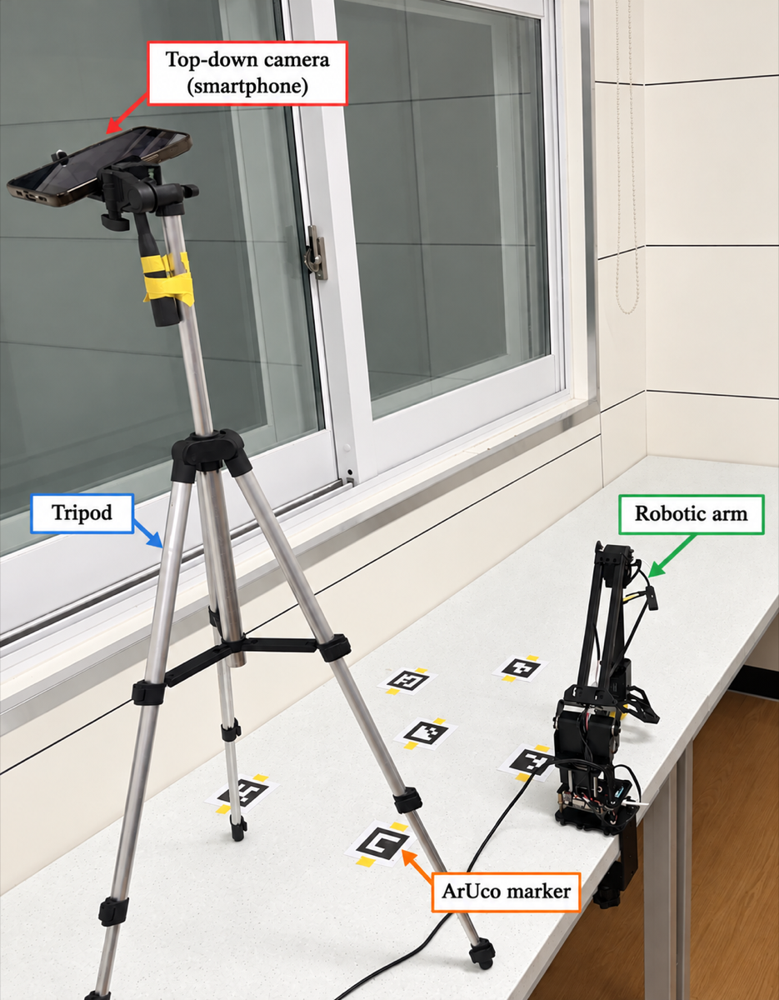
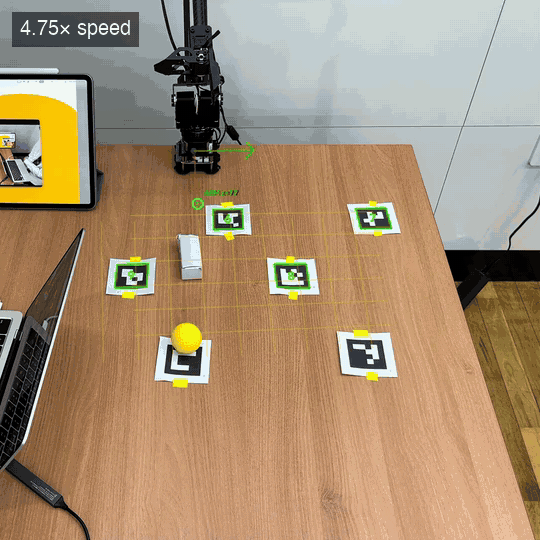

# RoArm-M2 pick-and-place (ArUco floor + Gemini VLM)
A voice/text-commanded pick-and-place system for the RoArm-M2 arm, built by **HR Robotics**, the robotics club at Haeryong High School (해룡고등학교).

<p align="center">
  &nbsp;&nbsp;
  
</p>
<p align="center"><sub>Left: hardware setup — a smartphone on a tripod as the top-down camera, ArUco markers on the table, RoArm-M2. Right: text-commanded pick-and-place (4.75× speed).</sub></p>


## Setup
```bash
python3 -m venv .venv && .venv/bin/pip install -r requirements.txt
echo "<GEMINI_API_KEY>" > gemini_api.txt      # never commit
```
Arm over USB (port auto-detected, check with `src/find_roarm.py`); a top-down webcam (index via `src/scan_webcams.py`).

## 1. Robot calibration (once)
```bash
.venv/bin/python src/teach_start_pose.py        # move arm to rest pose by hand, Enter   -> roarm_start_pose.json
.venv/bin/python src/calibrate_workspace.py     # teach x/y limits                        -> workspace_calibration.json
.venv/bin/python src/calibrate_floor.py         # gripper tip on the table, Enter         -> floor_calibration.json
```

## 2. ArUco floor calibration (camera can move afterwards)
```bash
.venv/bin/python src/make_aruco_markers.py                                    # print, tape >= 4 markers, not in a line
.venv/bin/python src/calibrate_aruco_floor.py --camera-index 0 --nudge        # arm goes to each marker, steer with i/k j/l u/o, Enter
.venv/bin/python src/calibrate_aruco_floor.py --camera-index 0 --auto --ids 6 7 8 9 10 11   # or: tip on marker by hand, Enter x2
.venv/bin/python src/goto_markers.py                                          # check: arm visits every marker
.venv/bin/python src/track_aruco_floor.py --camera-index 0                    # check: grid stays on the floor (r = rotate view)
```

## 3. Run
```bash
.venv/bin/python src/pick_place_record3d_to_eih.py --topdown webcam --topdown-camera-index 0 --floor aruco --place-mode command [--voice]
```
Type (or say) commands like "put the red block on 3", "swap A and B", "back where it was".
`3` / `3번 동작` replays a recorded motion, `3번 녹화` records one by hand (also `motions.py record|play|list|delete`). `q` quits.

Useful flags: `--pick-retries 2`, `--grasp-still-there-mm 40`, `--grip-empty-margin-rad 0.04`.
Env: `VLM_BACKEND=gemini|openai`, `GEMINI_MODEL`, `PLAN_THINKING=0`, `STT_BACKEND=gemini`, `TTS_BACKEND=say`.

## Files
- `src/pick_place_record3d_to_eih.py` main loop (planning, session memory, voice, motions)
- `src/vision.py` VLM: locate, multi-step plan, grasp check · `src/speech.py` STT/TTS
- `src/aruco_floor.py` per-frame pixel->robot homography from markers · `src/roarm_driver.py` arm I/O
- `src/pick_place.py`, `src/pick_place_record3d_rgb.py`, `src/record3d_camera.py`, `src/tracker.py`, `src/darkest_detector.py` support modules
- `src/motions.py` record/replay hand-taught motions
- `*.json` calibration values for this desk (redo steps 1-2 elsewhere)
